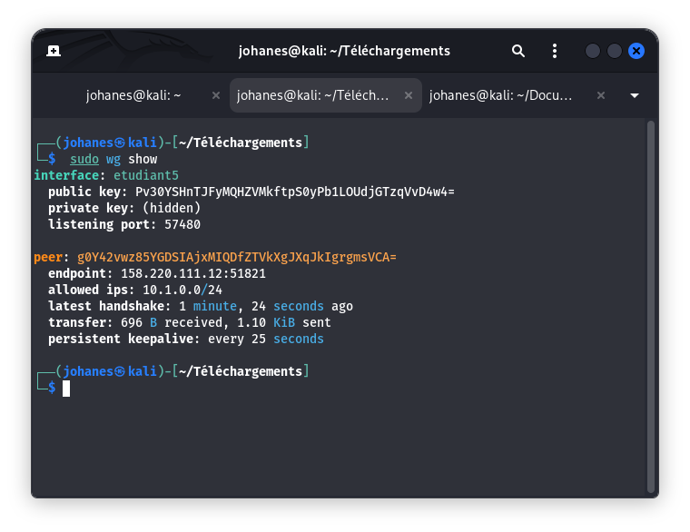
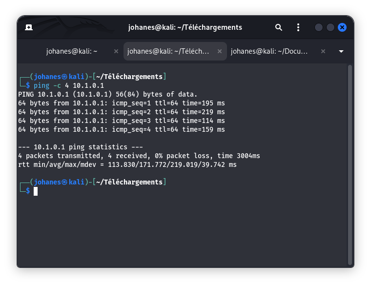

# 02 - Connexion VPN WireGuard

## 1. Objectif
Établir une liaison VPN sécurisée via WireGuard entre la machine attaquante (Kali Linux) et le réseau d'entraînement OURITEK / ESGIS afin de joindre la machine cible ESGIS VulnBox (`10.1.0.1`).

## 2. Prérequis
- Paquet `wireguard` et `wireguard-tools` installés sur Kali Linux.
- Fichier de configuration WireGuard `etudiant5.conf` conservé hors du dépôt Git conformément aux règles de sécurité (placé dans `/etc/wireguard/`).
- Connexion Internet active.

## 3. Procédure
1. Placement sécurisé de la configuration dans `/etc/wireguard/` avec droits restreints :
   ```bash
   sudo cp etudiant5.conf /etc/wireguard/
   sudo chmod 600 /etc/wireguard/etudiant5.conf
   ```
2. Désactivation de la directive `DNS` (pour éviter le conflit `resolvconf: signature mismatch` avec NetworkManager sous Kali Linux) :
   ```bash
   sudo sed -i 's/^DNS/#DNS/' /etc/wireguard/etudiant5.conf
   ```
3. Démarrage de l'interface WireGuard via `wg-quick` :
   ```bash
   sudo wg-quick up etudiant5
   ```
4. Vérification de l'interface et du statut du tunnel :
   ```bash
   sudo wg show
   ip addr show etudiant5
   ```
5. Test de connectivité ICMP vers la cible autorisée (`10.1.0.1`) :
   ```bash
   ping -c 4 10.1.0.1
   ```

## 4. Captures d'écran
- **Statut WireGuard (`sudo wg show`)** :
  
- **Test de connectivité réussi (`ping -c 4 10.1.0.1`)** :
  

## 5. Résultat observé
- Interface active : `etudiant5`
- Adresse IP attribuée : `10.1.0.6/24`
- Connectivité vers `10.1.0.1` : **4 paquets transmis, 4 reçus, 0% packet loss**.
- Temps de latence moyen observé : `~161 ms` (délai normal pour un tunnel chiffré transitant par Internet).

## 6. Analyse technique
- La communication chiffrée de bout en bout est opérationnelle.
- Le routage vers le sous-réseau `10.1.0.0/24` est convenablement injecté par `wg-quick`.
- La machine cible autorisée `10.1.0.1` est réactive et prête pour la phase de reconnaissance réseau.

## 7. Recommandations éventuelles
- Veiller à ne jamais commiter de fichier `*.conf` ou clé privée sur Git.
- Couper le tunnel une fois la session de laboratoire terminée : `sudo wg-quick down etudiant5`.
