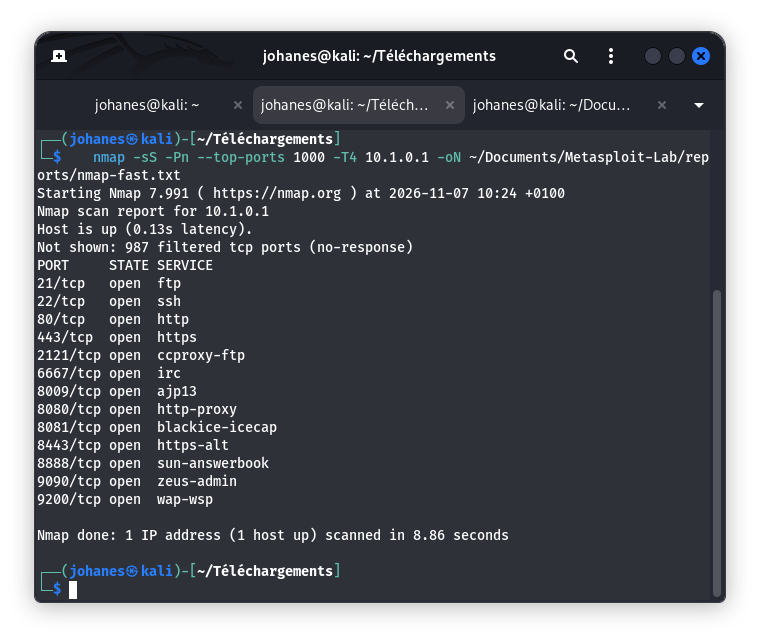
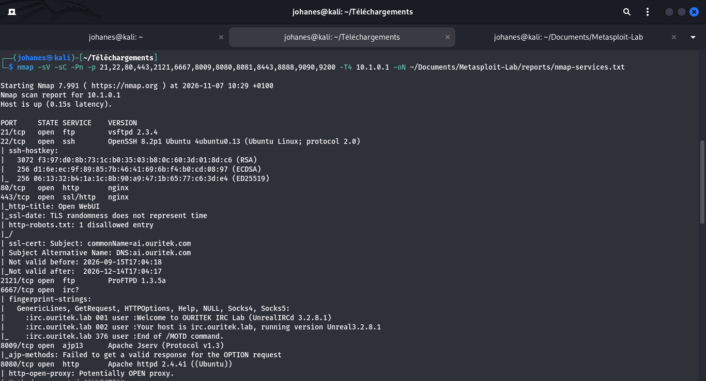

# 03 - Reconnaissance et Cartographie Réseau

## 1. Objectif
Cartographier la surface d'attaque de la machine cible autorisée **ESGIS VulnBox** (`10.1.0.1`), identifier l'ensemble des ports ouverts ainsi que les versions exactes des démons et services applicatifs en écoute.

## 2. Prérequis
- Tunnel VPN WireGuard actif (`interface etudiant5`, IP `10.1.0.6/24`).
- Connectivité réseau validée vers `10.1.0.1` (0% packet loss).
- Outil d'audit réseau : `nmap`.

## 3. Procédure
1. Scan rapide SYN des 1000 ports les plus fréquents :
   ```bash
   nmap -sS -Pn --top-ports 1000 -T4 10.1.0.1 -oN reports/nmap-fast.txt
   ```
2. Scan de caractérisation de versions logicielles et scripts par défaut sur les ports détectés :
   ```bash
   nmap -sV -sC -Pn -p 21,22,80,443,2121,6667,8009,8080,8081,8443,8888,9090,9200 -T4 10.1.0.1 -oN reports/nmap-services.txt
   ```

## 4. Captures d'écran
- **Scan initial de détection des ports ouverts** :
  
- **Caractérisation des services et bannières logicielles** :
  

## 5. Résultat observé
Le scan a permis de découvrir **13 ports TCP ouverts** sur l'hôte `10.1.0.1` (`vulnbox.ouritek.lab`) :

| Port TCP | État | Service | Logiciel et version exacte |
| :---: | :---: | :--- | :--- |
| **21** | Ouvert | FTP | `vsftpd 2.3.4` |
| **22** | Ouvert | SSH | `OpenSSH 8.2p1 Ubuntu 4ubuntu0.13` |
| **80** | Ouvert | HTTP | `nginx` |
| **443** | Ouvert | HTTPS | `nginx` (Open WebUI, certificat `ai.ouritek.com`) |
| **2121** | Ouvert | FTP | `ProFTPD 1.3.5a` |
| **6667** | Ouvert | IRC | `UnrealIRCd 3.2.8.1` |
| **8009** | Ouvert | AJP13 | `Apache Jserv Protocol v1.3` |
| **8080** | Ouvert | HTTP | `Apache httpd 2.4.41` (PHP 7.4.3, `phpinfo`) |
| **8081** | Ouvert | HTTP | `Apache Tomcat 7.0.109` (Coyote JSP engine 1.1) |
| **8443** | Ouvert | HTTPS-alt | `tcpwrapped` |
| **8888** | Ouvert | HTTP | `Apache httpd 2.4.41` (Répertoire `cgi-bin/`) |
| **9090** | Ouvert | HTTP | `nginx` |
| **9200** | Ouvert | REST API | `Elasticsearch 1.1.1` (Lucene 4.7) |

## 6. Analyse technique
- **Surface d'exposition très large** : 13 ports réseau distincts sont directement accessibles sans filtrage intermédiaire au niveau du tunnel.
- **Présence de versions logicielles historiques** : Plusieurs services exposent des versions logicielles datées connues pour comporter des failles documentées dans les bases publiques (ex. `vsftpd 2.3.4`, `ProFTPD 1.3.5a`, `UnrealIRCd 3.2.8.1`, `Apache Tomcat 7.0.109`, `Elasticsearch 1.1.1`).
- **Composants d'administration et protocoles internes exposés** : Le protocole AJP (`8009`) et l'API Elasticsearch (`9200`) sont exposés sur le réseau sans restriction d'hôte.

## 7. Recommandations éventuelles
- Appliquer le principe de minimisation des services en fermant tout port non indispensable.
- Restreindre l'accès aux interfaces de gestion et d'indexation (ports `8009`, `9200`) au seul trafic local (*localhost*).
- Programmer la mise à jour des démons réseau obsolètes vers des versions stables maintenues.
