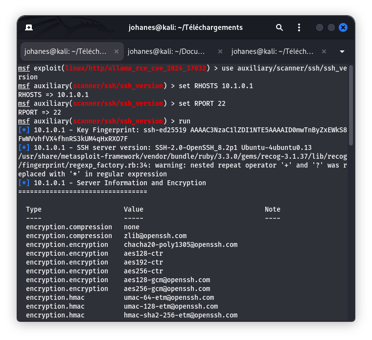

# Fiche Vulnérabilité N°10 — OpenSSH 8.2p1 (CVE-2020-15778)

## 1. Contexte et Identification

- **Service cible** : OpenSSH
- **Port d'écoute** : `22/tcp`
- **Version détectée** : `OpenSSH 8.2p1 Ubuntu-4ubuntu0.13`
- **Système identifié** : Ubuntu 20.04
- **Référence CVE** : `CVE-2020-15778`
- **Score CVSS v3** : `7.8 (Élevé)`
- **Cible autorisée** : ESGIS VulnBox (`10.1.0.1`)

## 2. Observations Techniques

- **Description** : Serveur OpenSSH identifié grâce au module de détection de version `auxiliary/scanner/ssh/ssh_version`.
- **Vecteur d'exposition** : Port SSH accessible à travers le tunnel WireGuard (`10.1.0.1:22`).
- **Contexte de la faille** : CVE-2020-15778 concerne le client `scp` d'OpenSSH jusqu'à la version 8.3p1. Une mauvaise gestion de certains arguments de destination peut permettre une injection de commandes via des caractères spéciaux, notamment les backticks.
- **Condition d'exploitation** : L'exploitation nécessite une authentification SSH valide et l'utilisation de `scp` dans un contexte vulnérable.

## 3. Preuves Techniques

### 3.1. Détection de la version SSH



**Sortie console :**

```text
[*] 10.1.0.1 - SSH server version: SSH-2.0-OpenSSH_8.2p1 Ubuntu-4ubuntu0.13

[+] 10.1.0.1 - Server Information and Encryption
=================================

service.version          8.2p1
os.version               20.04
```

**Observation :**

Le serveur expose le service SSH sur le port 22 et annonce la version OpenSSH 8.2p1, ce qui justifie une vérification de son niveau de correctifs.

### 3.2. Vérification de l'authentification SSH

- **Méthode documentée** : Vérification de l'authentification SSH avec le module `auxiliary/scanner/ssh/ssh_login`.
- **Compte concerné** : `root`.
- **Résultat observé** : Aucun identifiant valide n'a été obtenu lors du test.

**Conclusion :**

Aucun accès SSH authentifié n'a été établi pendant cette vérification. Les conditions nécessaires à la démonstration de CVE-2020-15778 ne sont donc pas réunies.

> **Limite de la preuve :** l'absence d'identifiants valides lors du test ne prouve pas que le compte est inexistant ou que son mot de passe est robuste.

## 4. Analyse de l'Impact

Si les conditions d'exploitation sont réunies, cette vulnérabilité peut permettre à un utilisateur authentifié de provoquer l'exécution de commandes sur la machine distante dans le contexte du transfert de fichiers concerné.

L'impact réel dépend notamment :
- Des privilèges du compte SSH utilisé.
- De la configuration du service SSH.
- De la version effectivement corrigée ou non du paquet installé.

**État de la démonstration :** la version annoncée est potentiellement concernée, mais l'exploitation n'a pas été démontrée.

## 5. Mesures Correctives et Remédiation

- **Mise à jour logicielle** : Installer une version d'OpenSSH contenant le correctif de CVE-2020-15778. Vérifier les correctifs rétroportés par Ubuntu plutôt que de se fier uniquement au numéro de version amont.
- **Authentification** : Privilégier l'authentification par clés SSH et désactiver l'authentification par mot de passe lorsqu'elle n'est pas nécessaire.
- **Filtrage réseau** : Restreindre l'accès au port `22/tcp` aux seuls réseaux d'administration autorisés.
- **Surveillance** : Surveiller les connexions SSH et les tentatives d'authentification anormales avec des outils tels que Fail2Ban ou un IDS/IPS.
- **Principe du moindre privilège** : Éviter les connexions SSH directes avec le compte `root`.

## 6. Conclusion

Le scan confirme la présence d'un serveur OpenSSH 8.2p1 sur le port 22 de la machine cible.

Cette version annoncée justifie une vérification de la présence du correctif associé à CVE-2020-15778. Cependant, aucune exploitation n'a été démontrée, car aucun accès SSH authentifié n'a été obtenu.

**Statut :** En attente de vérification du correctif et de validation des conditions d'exploitation.

**Classification :** Version potentiellement concernée — exploitation non démontrée.